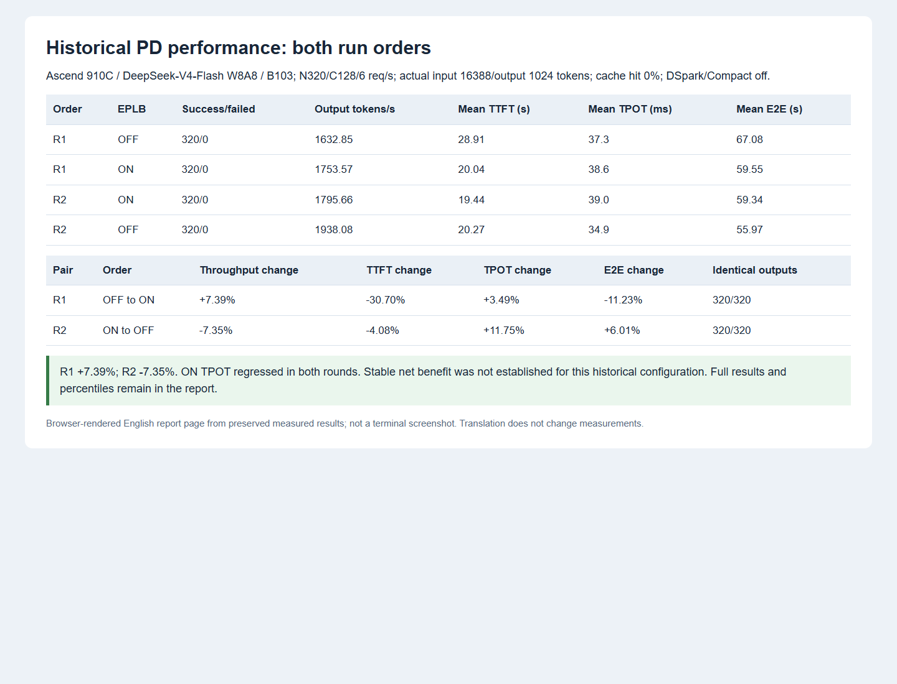
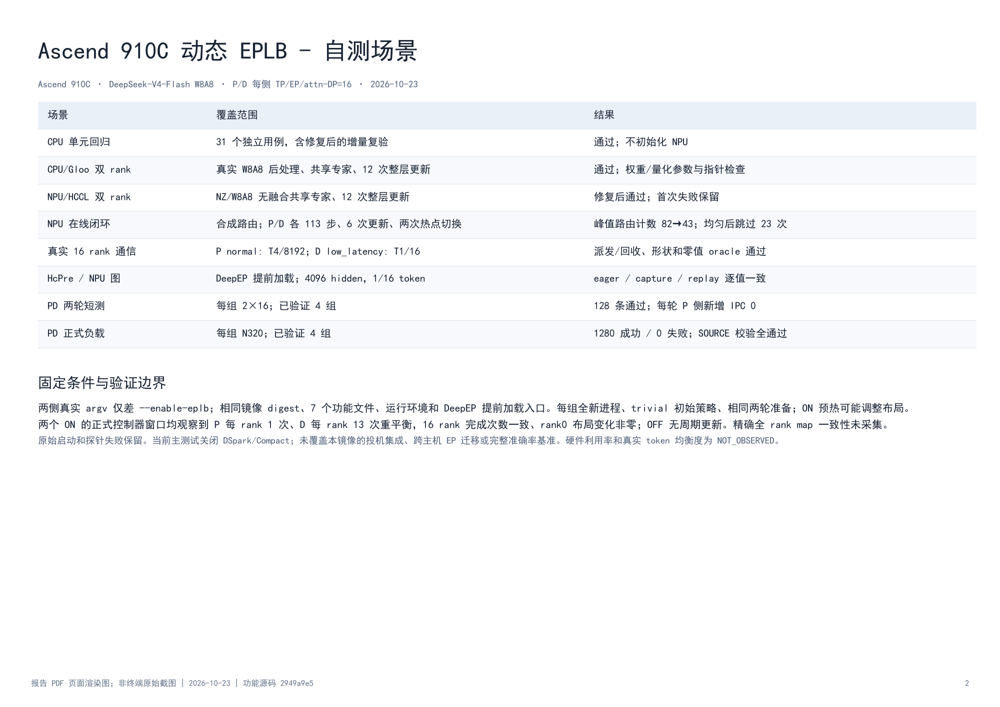

> 历史版本报告（优化前 PD 对照）。后续单机优化与最终代码验证见[最新自测报告](ascend_dynamic_eplb_delivery_20261024.md)；本页旧结果和负向记录保留。

# Ascend 910C 动态 EPLB：B103 自测验证报告

Ascend 910C · DeepSeek-V4-Flash W8A8 · P/D 每侧 TP/EP/attn-DP=16 · 2026-10-23

B103 / CANN 9.1.0 / torch_npu 2.10.0.post6；N320 / C128 / 6 req/s；实际输入 16388、输出固定 1024 token、缓存命中率 0%。DSpark、Compact 关闭；无离线优化布局，trivial/static，P16/D0 冗余预算。

## 执行与口径

两种顺序分别为 R1 OFF→ON、R2 ON→OFF。每组全新进程从 trivial 启动，执行相同两轮 PD 准备；ON 预热可能已调整布局，不声称正式起点布局相同。两侧真实 argv 仅差 `--enable-eplb`，环境、7 个功能文件和依赖入口一致。

基线无离线优化布局；`static` 为派发方式，动态 EPLB 会更新它使用的映射表。模型普通执行图保持一致，D 使用 1/2/4/6/8/12/16 的图批次，P 关闭图。

## 测试场景与结果

| 场景 | 覆盖范围 | 结果 |
|---|---|---|
| CPU 单元回归 | 31 个独立用例，含修复后的增量复验 | 通过；不初始化 NPU |
| CPU/Gloo 双 rank | 真实 W8A8 后处理、共享专家、12 次整层更新 | 通过；权重/量化参数与指针检查 |
| NPU/HCCL 双 rank | NZ/W8A8 无融合共享专家、12 次整层更新 | 修复后通过；首次失败保留 |
| NPU 在线闭环 | 合成路由；P/D 各 113 步、6 次更新、两次热点切换 | 峰值路由计数 82→43；均匀后跳过 23 次 |
| 真实 16 rank 通信 | P normal: T4/8192；D low_latency: T1/16 | 派发/回收、形状和零值 oracle 通过 |
| HcPre / NPU 图 | DeepEP 提前加载；4096 hidden，1/16 token | eager / capture / replay 逐值一致 |
| PD 两轮短测 | 每组 2×16；已验证 4 组 | 128 条通过；每轮 P 侧新增 IPC 0 |
| PD 正式负载 | 每组 N320；已验证 4 组 | 1280 成功 / 0 失败；SOURCE 校验全通过 |

## 全部请求区间

| 执行顺序 | EPLB | 成功/失败 | 输出 token/s | TTFT 均值(s) | TPOT 均值(ms) | E2E 均值(s) |
|---|---|---|---|---|---|---|
| R1 | OFF | 320/0 | 1632.85 | 28.91 | 37.3 | 67.08 |
| R1 | ON | 320/0 | 1753.57 | 20.04 | 38.6 | 59.55 |
| R2 | ON | 320/0 | 1795.66 | 19.44 | 39.0 | 59.34 |
| R2 | OFF | 320/0 | 1938.08 | 20.27 | 34.9 | 55.97 |

| 配对 | 执行顺序 | 吞吐变化 | TTFT 变化 | TPOT 变化 | E2E 变化 | 输出文本一致 |
|---|---|---|---|---|---|---|
| R1 | OFF→ON | +7.39% | -30.70% | +3.49% | -11.23% | 320/320 |
| R2 | ON→OFF | -7.35% | -4.08% | +11.75% | +6.01% | 320/320 |

只比较同源同配置的 EPLB 开关；whole 含统计、规划、通信、迁移及排空。负号表示延迟减少，TPOT 正号表示退化。尚不泛化为其他数据或最大容量收益。

## 原 AIS 原生稳态

| 组别 | 原生稳态 N | TTFT 均值(s) | TPOT 均值(ms) | E2E 均值(s) |
|---|---|---|---|---|
| R1_OFF | 192 | 21.99 | 33.7 | 56.44 |
| R1_ON | 190 | 16.48 | 38.2 | 55.61 |
| R2_ON | 192 | 14.01 | 39.0 | 53.91 |
| R2_OFF | 191 | 15.59 | 35.0 | 51.39 |

各组稳态样本 N 为原 AIS 算法选择，完整区间主结论不以稳态替代；native 复用原产物计算，无新推理。

## 截图

以下为原始数据生成的报告 PDF 页面渲染图，不是终端原始截图。





## 环境与失败记录

镜像标签 `cann9.1.0-a3-B103`；digest `sha256:45519e8921b54ae6424922d9934b734f9f7d126c1dc19ff0c10951f9c122dbbd`。Python 3.12.13/aarch64、PyTorch 2.10.0+cpu、torch_npu 2.10.0.post6、CANN 9.1.0。实测功能提交 `2949a9e58b31eeed591589ecf609af777552f994`，基于 `feat/dev_ep@d3c76503`。后续只格式化 3 个测试文件，AST 与功能源码字节均不变。

曾因 vendor OPP、角色 DeepEP 缓冲参数和加载顺序遗漏导致启动/小探针失败。补齐后，统一在 NPU 初始化前加载镜像自带 DeepEP OPP，先通过真实 HcPre 图与 16 rank 通信探针，再执行本报告的正式四组；失败记录保留。原端口/路由准入与本机 python3 入口问题单列为编排/检查问题，不算模型性能回归。

本机 pre-commit 的格式、isort、ruff、codespell 等检查通过；三个依赖 `python3` 系统入口的 hook 改用实际 Python 解释器执行同一原脚本，均 exit 0。

## 适用范围

这是固定复制 SOURCE 合成负载的功能与性能测试。AIS 产物沿用 gsm8k 文件名，内容不是 GSM8K 数学准确率；未做完整准确率基准。每组 320 条非空输出均为独立 SOURCE 的精确前缀，固定 1024 token 允许截断。

DSpark/Compact 关闭，本镜像投机集成和跨主机 EP 迁移未覆盖。AL、严格 draft 接受率、gamma/verify 分母为 NOT_APPLICABLE；硬件利用率和真实 token 均衡度未在主性能测试中采集，记 NOT_OBSERVED。日志能证明布局调整，不能替代设备 profiling；TPOT 的退化如实保留。

自测原始回包、日志、源码 SHA、whole/native、独立答案 oracle 已归档并逐文件校验。本仓库提交脱敏报告和截图，不提交内部网络地址、账号、权重目录和大体积原数据。

## 分位数与结论

| 组别 | 指标 | 均值 | p50 | p99 | 最大值 |
|---|---|---|---|---|---|
| R1_OFF | TTFT | 28913.0 ms | 26767.7 ms | 50229.8 ms | 50793.7 ms |
| R1_OFF | TPOT | 37.3 ms | 35.4 ms | 49.3 ms | 49.3 ms |
| R1_OFF | E2EL | 67079.1 ms | 61820.5 ms | 90550.0 ms | 90798.7 ms |
| R1_OFF | ITL | 37.2 ms | 36.5 ms | 48.2 ms | 2867.3 ms |
| R1_ON | TTFT | 20035.6 ms | 19272.2 ms | 33892.4 ms | 34263.2 ms |
| R1_ON | TPOT | 38.6 ms | 38.6 ms | 41.7 ms | 41.7 ms |
| R1_ON | E2EL | 59546.7 ms | 59488.9 ms | 73563.4 ms | 74268.6 ms |
| R1_ON | ITL | 38.5 ms | 37.8 ms | 51.9 ms | 2037.1 ms |
| R2_ON | TTFT | 19442.5 ms | 17917.7 ms | 36685.3 ms | 37165.9 ms |
| R2_ON | TPOT | 39.0 ms | 39.1 ms | 40.9 ms | 41.1 ms |
| R2_ON | E2EL | 59340.5 ms | 57594.9 ms | 77289.1 ms | 77968.1 ms |
| R2_ON | ITL | 38.9 ms | 38.3 ms | 92.0 ms | 1941.4 ms |
| R2_OFF | TTFT | 20269.6 ms | 17892.5 ms | 37765.1 ms | 38573.0 ms |
| R2_OFF | TPOT | 34.9 ms | 35.0 ms | 37.4 ms | 37.5 ms |
| R2_OFF | E2EL | 55974.8 ms | 53768.6 ms | 74246.8 ms | 75039.6 ms |
| R2_OFF | ITL | 34.8 ms | 37.1 ms | 47.4 ms | 342.7 ms |

原始报表不提供 p95，记 NOT_OBSERVED，不从其他分位数推算。

R1 吞吐 +7.39%，R2 吞吐 -7.35%，方向相反；当前未验证稳定净收益。ON 两轮 TPOT 均退化，R2 的 E2E 也退化，不能只报告首对正向数字。首个 OFF 比后续 OFF 慢是事实；冷编译、调度和运行状态仍是待核实的解释，不写成已确定根因。

正式控制器窗口中，两个 ON 均为 P 每 rank 1 次、D 每 rank 13 次完成的重平衡，16 rank 完成次数一致；rank0 布局 diff 均非零。精确全 rank map 一致性未采集；日志时间只有秒级精度，不将其当作设备迁移成本。OFF 两侧均无周期重平衡。

## 手工小测试复现

在相同 B103 NPU 运行环境、仓库根目录执行；不启动完整模型：

```bash
export PYTHONPATH=python:${PYTHONPATH}
python -m torch.distributed.run --standalone --nproc-per-node=2  test/manual/ep/test_eplb_weight_migration.py --device npu --weight-format nz  --w8a8-postprocess --no-fused-shared --all-layers-per-update
python -m torch.distributed.run --standalone --nproc-per-node=2  test/manual/ep/test_eplb_online_loop.py --device npu  --reuse-tp-group --rebalance-threshold 0.9
```

## 服务关键配置

| 参数 | P | D |
|---|---|---|
| TP / EP / attention-DP / 独立 replica | 16 / 16 / 16 / 1 | 16 / 16 / 16 / 1 |
| DeepEP / 初始布局 / 派发 | normal / trivial / static | low_latency / trivial / static |
| 冗余专家 / 静态显存比例 | 16 / 0.62 | 0 / 0.71 |
| EPLB 周期 / 统计窗口 | 48 / 48 | 320 / 320 |
| 每 chunk 重平衡层数 / 利用率阈值 | 64 / 1.0 | 64 / 1.0 |
| chunked prefill CLI / 实际每 rank | 131072 / 8192 | 默认 8192 / 512 |
| prefill max requests / 普通图 | 2 / disabled | 默认 / full，bs=1,2,4,6,8,12,16 |
| HCCL_BUFFSIZE / DEEPEP_HCCL_BUFFSIZE (MB) | 200 / 2600 | 200 / 1200 |
| DeepEP 每轮 token / long seq rounds | 8192 / 1 | 2048 / 8 |
| max dispatch tokens per rank | 128 | 128 |
| expert balancedness report / 布局日志 | off / 开启 | off / 开启 |
| 量化 / KV dtype / page size | modelslim W8A8 / bfloat16 / 128 | modelslim W8A8 / bfloat16 / 128 |
| use_index_cache / index_topk_freq | true / 2 | true / 2 |

布局日志为两组共同固定的环境设置，ON 实际产生的日志成本也在完整区间内。CANN customize/custom_transformer vendor 环境及 DeepEP 自带 OPP 均需在对应算子首次初始化前准备好。测试入口只提前导入 DeepEP 后执行原 SGLang 启动模块，不注入旧 WOA/Compact/PD helper。
