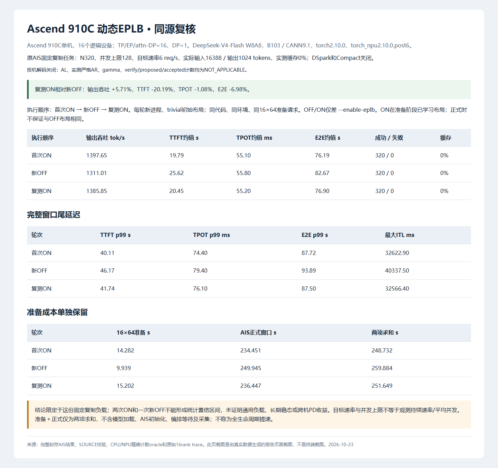
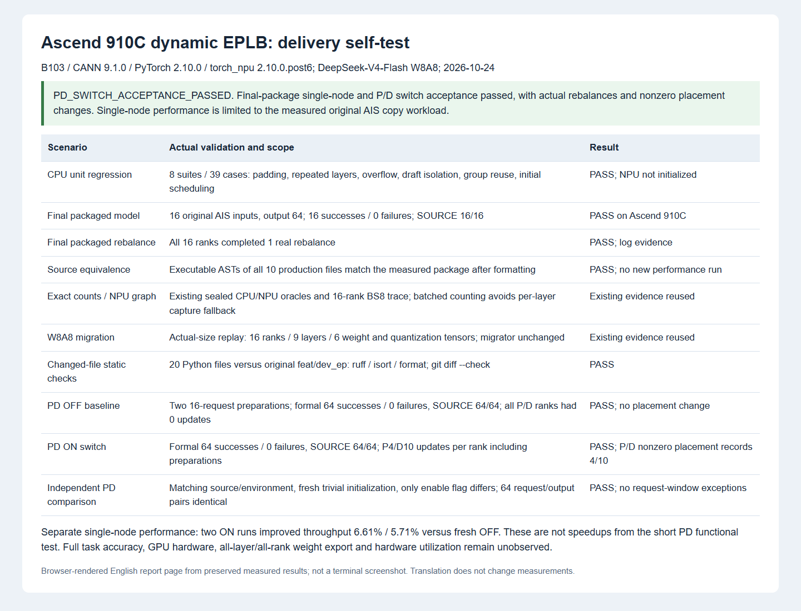

# Ascend 910C 动态 EPLB：最终自测报告

最终包内版本单机、PD 分离场景动态 EPLB 开关验收均通过。2026-10-24。生产代码提交 `3683421a24e3917332923ddbab37490f849e7f49`。

## 改动与正确性基线

复用固定社区提交 `611a70306197239593959cb47a9fa92a9913dd18` 的规划与迁移调度，在 `feat/dev_ep` 上单独提交 NPU 适配。新增有效 sender TopK 计数、padding 统计屏蔽、draft 与 target 统计隔离、独立 HCCL 迁移组、W8A8/NZ 的 ND 暂存迁移，以及图捕获边界下的批量精确统计。满足条件的 NPU 单机 trivial/static 初始布局仅将第一次学习周期缩至 64；后续间隔和窗口不变。

`static` 是派发映射的使用方式，ON 时映射仍由动态 EPLB 更新。基准均从新进程、trivial 布局开始，未加载离线优化布局；不是把 ON 已学习的布局交给下一次 OFF。冗余专家预算在对照两组保持一致。

CPU 39 用例通过，实际 NPU 图与权重迁移的证明范围见场景表。最终包内版本单机 16 条原 AIS 输入、64 输出 token 全部成功，SOURCE 校验 16/16，各 rank 均有真实重平衡完成记录。最终分支仅做格式整理，10 个生产文件的可执行 AST 与该实测版本逐一相等，源码和归档 SHA 见 [SOURCE_BINDING.json](ascend_dynamic_eplb_delivery_20261024/SOURCE_BINDING.json)。AST 等价不额外宣称 GPU 实机或通用精度已经验证。

仓库适用的 pre-commit 检查、isort、ruff、codespell 均通过；3 个依赖 Windows 不可用 `python3` 别名的系统钩子用实际 Python 执行同一原脚本，均 exit 0。

## 单机已完成的性能复核

B103 / CANN 9.1.0 / PyTorch 2.10.0 / torch_npu 2.10.0.post6，DeepSeek-V4-Flash W8A8；16 个逻辑设备，TP/EP/attn-DP=16、DP=1。原 AIS 固定复制负载 N320、并发上限 128、目标 6 req/s，实际输入 16388 / 输出 1024 token，缓存命中 0%，DSpark、Compact 关闭。初次学习 64，后续间隔 640、窗口 320，冗余专家 16。

执行顺序为首次 ON → 新 OFF → 复测 ON，每次新进程、同源同环境、同 16×64 准备请求，只有 `--enable-eplb` 不同。ON 准备阶段会学习布局，正式起点布局不保证相同。

| 轮次 | 输出吞吐 tok/s | TTFT 均值 s | TPOT 均值 ms | E2E 均值 s | 成功 / 失败 |
|---|---:|---:|---:|---:|---:|
| 首次 ON | 1397.65 | 19.79 | 55.10 | 76.19 | 320 / 0 |
| 新 OFF | 1311.01 | 25.62 | 55.80 | 82.67 | 320 / 0 |
| 复测 ON | 1385.85 | 20.45 | 55.20 | 76.90 | 320 / 0 |

两次 ON 相对新 OFF 为 +6.61% / +5.71%；最新 TTFT -20.19%、TPOT -1.08%、E2E -6.98%。三轮 320 组输入及输出逐字相同，各 SOURCE 320/320。准备加正式请求窗口求和减少 3.17%，未包含模型加载、AIS 初始化、编排等待与采集，不称为完整生命周期收益。

性能数字来自冻结的 `singlecapture_v1`。后续包内命名整理、日志及格式变更有等价证明和上述整模型功能验证，没有重跑性能，也不产生新的性能增益主张。两次 ON 与一次 OFF 是固定负载复现，不能给出统计置信区间或推广为所有业务收益。

## 当前测试场景与截图

两图均为从真实数据生成的报告页面截图，不是终端截图。性能图复用 2026-10-23 已渲染结果，当前交付场景图为 2026-10-24。

PD 功能实测配置：P/D 各 16 rank，OFF/ON 同配置，trivial 初始布局、radix cache / DSpark / Compact 关闭；P/D 触发间隔分别 4/64，仅为验收更容易观察迁移。前置两轮各 16 请求、16 输出；正式 64 请求、并发 16、输出 128。输入使用原 SOURCE 截取 2048 字符，实际 token 以回包为准，这是短功能验收，不与上述 16K AIS 性能混算。

实际正式输入 689–708 token，输出固定 128 token。OFF/ON 两侧真实启动回执的源码 manifest、入口、镜像、相关环境与参数逐项相等，仅 `--enable-eplb` 不同；ON 是全新进程，重新加载权重并从 trivial 开始。P/D 各 16 rank 的实际开关均由 `server_info` 核实。

| 开关 | 两轮准备成功数 | 正式成功 / 失败 | SOURCE | P 每 rank 完成更新 | D 每 rank 完成更新 | P/D 非零布局变化记录 |
|---|---:|---:|---:|---:|---:|---:|
| OFF | 16 + 16 | 64 / 0 | 64/64 | 0 | 0 | 0 / 0 |
| ON | 16 + 16 | 64 / 0 | 64/64 | 4 | 10 | 4 / 10 |

更新次数按包含两轮准备的请求窗口统计，日志为秒级时间，起止边界分别留 1 秒/3 秒容差；不把整个服务生命周期中的健康探测和启动预热更新代替请求窗口计数。两组正式 64 对请求和输出逐字相同，独立 SOURCE 前缀校验均通过。总计 192 次计划请求全部成功，正式及准备区间两侧无 ERROR、Traceback 或调度异常。布局变化记录是 rank 0 的日志记录数，不是完整权重逐值校验或硬件利用率证明。原始归档 SHA、各 rank 计数和结果见 [PD_ACCEPTANCE.json](ascend_dynamic_eplb_delivery_20261024/PD_ACCEPTANCE.json)。

两轮准备加正式功能流程耗时 OFF 31.867 秒、ON 36.623 秒。本次 P4/D64 是为覆盖真实迁移而设的高频功能配置；这两个耗时如实保留，不作为稳态 PD 净收益结论，也不与上述单机 AIS 测量混算。尚未完成当前优化版本的稳定 PD 性能收益验证。

目标 `feat/dev_ep` 在实机验收后推进至 `8e69805c`。与功能分支的合并预览无文本冲突，在隔离源码副本上重新执行同 39 项 CPU 用例全部通过、未初始化 NPU，也未更改热服务。新目标分支自身改动不冒作已经过本轮实机验证，见 [BASE_COMPATIBILITY.json](ascend_dynamic_eplb_delivery_20261024/BASE_COMPATIBILITY.json)。

## 启动与统计修复记录

D 首次 OFF 启动因另一计算容器占显存，未通过 KV 预算检查；提高显存比例的第二次启动通过内存检查，但默认通信端口被占用。清理竞争容器、恢复原 0.71 和默认端口后，第三次启动成功。一次 HTTP 子进程退出后由服务自动替换，恢复连接时原服务已完整就绪，没有为此重载模型。这些失败均发生在本轮 PD 客户端请求之前，原始日志保留。

OFF→ON 切换入口曾被路由进程改名和 D 侧旧候选路径守卫拒绝，均未停止原模型；核实 PID/启动时间/可执行文件/监听端口后修复编排入口，保留身份守卫并成功切换。模型代码未因此变更。封存后首次日志汇总未识别带进度点前缀的一行，已仅对同一份原日志按每行时间和 TP rank 重算，得到各 rank P4/D10；没有重发请求或替换原始归档。此前 CPU mock 清理错误也已修正并通过新进程 39 用例回归。这些记录不混入模型性能结果。

## 历史结果与边界

[优化前 PD 报告](ascend_dynamic_eplb_b103.md) 保留原始正序 +7.39% 和反序 -7.35% 结果，属于旧版本，不能与上述单机优化结果拼成同一组对照，也不能用来替代当前最终版本的 PD 验收。

完整准确率基准、GPU 硬件回归、全 43 层全 rank 权重逐值导出、主性能负载实际 token 均衡度与硬件利用率均未观测。复制 SOURCE 一致性不等于完整模型准确率。投机关闭，AL、严格 draft 接受率及 gamma/verify/proposed/accepted 分母均为 NOT_APPLICABLE。失败和负向结果完整保留，当前功能验收已完成；PR 的性能结论限定于上述单机固定负载。
